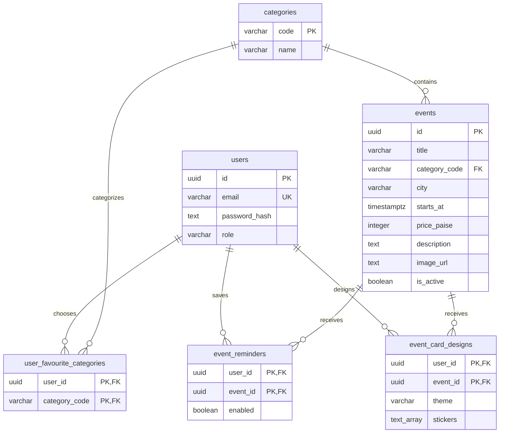

# Community Events Board database

PostgreSQL 14+ and Sequelize. This document describes the six application tables implemented by the models and migrations. Business APIs, password hashing, admin credentials, and the 15 sample events are still pending. Only the five assignment categories are seeded.

## Relationships



Audit relationships are omitted from the diagram for readability. Every table also has the following columns:

| Column       | SQL type    | Null? | Default / rule                         |
| ------------ | ----------- | ----- | -------------------------------------- |
| `created_at` | TIMESTAMPTZ | No    | `CURRENT_TIMESTAMP`                    |
| `updated_at` | TIMESTAMPTZ | No    | `CURRENT_TIMESTAMP`                    |
| `created_by` | UUID        | Yes   | FK to `users.id`, `ON DELETE SET NULL` |
| `updated_by` | UUID        | Yes   | FK to `users.id`, `ON DELETE SET NULL` |

All identifier updates use `ON UPDATE RESTRICT`, including audit references. Users have self-referencing audit FKs. System migrations and unauthenticated signup writes use null actors. SQL columns use snake_case; typed model attributes use camelCase and `underscored: true`.

## Columns and constraints

Application columns below are NOT NULL. UUID primary keys default to `gen_random_uuid()` in PostgreSQL and UUID v4 in models. Composite keys have no extra ID column.

### users

| Column          | SQL type     | Rule                                              |
| --------------- | ------------ | ------------------------------------------------- |
| `id`            | UUID         | Primary key                                       |
| `email`         | VARCHAR(254) | Trimmed, lowercase, nonblank, unique              |
| `password_hash` | TEXT         | Nonblank encoded hash; never a plaintext password |
| `role`          | VARCHAR(8)   | `user` or `admin`, default `user`                 |

The model trims/lowercases email and validates its format; the database enforces canonical storage and uniqueness. Password hashing is **not implemented in this phase**. A nonblank check cannot prove that a string is a secure password hash; the later authentication service must generate and verify salted hashes using a suitable password hashing algorithm. See [OWASP password storage guidance](https://cheatsheetseries.owasp.org/cheatsheets/Password_Storage_Cheat_Sheet.html).

Default reads exclude `passwordHash`. The named `authentication` scope includes it for credential verification. Create results and deliberately unscoped queries can still contain the hash: future API responses must explicitly select safe DTO fields.

### categories

| Column | SQL type    | Rule                                                         |
| ------ | ----------- | ------------------------------------------------------------ |
| `code` | VARCHAR(32) | Primary key; lowercase identifier matching `[a-z][a-z0-9-]*` |
| `name` | VARCHAR(40) | Nonblank display name                                        |

The category migration inserts `music/Music`, `workshop/Workshop`, `food/Food`, `sports/Sports`, and `kids/Kids`. Stable codes avoid coupling URLs and records to display names. A lookup table permits future categories through data migrations without changing a PostgreSQL enum. Deletion is restricted while events or favourites reference a category.

### events

| Column          | SQL type     | Rule                                                |
| --------------- | ------------ | --------------------------------------------------- |
| `id`            | UUID         | Primary key                                         |
| `title`         | VARCHAR(200) | Nonblank, trimmed by model                          |
| `category_code` | VARCHAR(32)  | FK to `categories.code`, delete restricted          |
| `city`          | VARCHAR(100) | Nonblank, trimmed by model                          |
| `starts_at`     | TIMESTAMPTZ  | A finite instant; past events are allowed           |
| `price_paise`   | INTEGER      | Nonnegative; `0` means free                         |
| `description`   | TEXT         | Nonblank                                            |
| `image_url`     | TEXT         | Nonblank HTTP(S) URL; model validates URL structure |
| `is_active`     | BOOLEAN      | Default `true`                                      |

One event has exactly one category. Deactivation retains the event: no `deleted_at` column or deletion API is planned. Database FKs also restrict deletion while reminders or designs reference an event; this is not a blanket prohibition on administrative SQL deletion.

Store `15000000` paise for ₹1,50,000; convert to rupees for Indian formatting in the UI. Integer storage avoids floating point rounding. Future APIs must accept date inputs with an explicit timezone, and the UI displays `Asia/Kolkata`. PostgreSQL represents TIMESTAMPTZ instants internally in UTC; session timezone controls textual display. See [PostgreSQL date/time documentation](https://www.postgresql.org/docs/current/datatype-datetime.html).

### user_favourite_categories

`user_id UUID` references users with delete cascade; `category_code VARCHAR(32)` references categories with delete restrict. Their pair is the primary key. Removing a favourite deletes this association row. No separate preference or feed table is needed.

### event_reminders

`user_id UUID` references users with delete cascade; `event_id UUID` references events with delete restrict. Their pair is the primary key. `enabled BOOLEAN` defaults to `true`. Toggling updates the existing row; absence means disabled. This stores a preference and does not schedule or deliver notifications.

### event_card_designs

`user_id UUID` references users with delete cascade; `event_id UUID` references events with delete restrict. Their pair is the primary key.

| Column     | SQL type    | Rule                                                   |
| ---------- | ----------- | ------------------------------------------------------ |
| `theme`    | VARCHAR(16) | `sunset`, `ocean`, `forest`; default `sunset`          |
| `stickers` | TEXT[]      | Default empty array; zero to three ordered sticker IDs |

Allowed IDs: `star`, `heart`, `music-note`, `sparkles`, `party`. Nonempty arrays must be one dimensional with the normal one-based lower bound and contain no nulls. Repeated IDs are allowed. A database CHECK enforces size, dimensions, and membership; model validation rejects invalid arrays before SQL execution. Empty arrays are accepted (PostgreSQL represents them with no dimensions). Guest choices belong in browser storage; signed-in choices belong to the user/event pair.

## Indexes

| Table                     | Index / purpose                                                                   |
| ------------------------- | --------------------------------------------------------------------------------- |
| users                     | UUID primary key; `uq_users_email` unique email constraint/index                  |
| categories                | Code primary key                                                                  |
| events                    | UUID primary key; `idx_events_active_start` on `(is_active, starts_at, id)`       |
| events                    | `idx_events_category_active_start` on `(category_code, is_active, starts_at, id)` |
| events                    | `idx_events_city_active_start` on `(lower(city), is_active, starts_at, id)`       |
| user_favourite_categories | Pair primary key; `idx_favourites_category` on `(category_code)`                  |
| event_reminders           | Pair primary key; `idx_reminders_event` on `(event_id)`                           |
| event_card_designs        | Pair primary key; `idx_designs_event` on `(event_id)`                             |

Pair primary keys support per-user reads and prevent duplicate preferences. Reverse FK indexes support category/event lookups and integrity checks. Do not add every combination of optional filters. Audit actor indexes can be added if audit lookup workloads justify them. Do not put `now()` in a partial index predicate: the upcoming set changes with time.

Substring search initially scans candidate title/description values. If measured workload warrants it and the extension is available, add `pg_trgm` and separate GIN trigram indexes on title and description in a later migration. Very short searches can still have poor selectivity. See [PostgreSQL pg_trgm documentation](https://www.postgresql.org/docs/current/pgtrgm.html).

## Query contract (business endpoints remain pending)

Browse requires `is_active = true AND starts_at > :now`. Add category, city, and text predicates together with AND. Use one captured `:now` and the same predicates for the result and count queries. Optional parameters below use null to mean no filter; actual APIs should omit unused predicates when building their Sequelize query.

```sql
SELECT e.* FROM events AS e
WHERE e.is_active = true AND e.starts_at > :now
  AND (:category IS NULL OR e.category_code = :category)
  AND (:city IS NULL OR lower(e.city) = lower(:city))
  AND (:pattern IS NULL OR
       e.title ILIKE :pattern ESCAPE E'\\' OR
       e.description ILIKE :pattern ESCAPE E'\\')
ORDER BY e.starts_at ASC, e.id ASC
LIMIT :limit OFFSET :offset;
```

Pass parameters separately, never interpolate user input into SQL. For literal substring search, escape backslash, `%`, and `_` before surrounding the text with `%`:

```ts
const pattern = `%${search.replace(/[\\%_]/g, '\\$&')}%`;
```

Use `SELECT count(*)` with the same WHERE clauses for pagination metadata. The ID tie breaker gives deterministic ordering for equal timestamps; offset pagination can still shift when events are inserted or updated between requests.

Feed adds the following predicate to the active/upcoming query (and optional filters if supported later):

```sql
AND EXISTS (
  SELECT 1 FROM user_favourite_categories AS f
  WHERE f.user_id = :authenticatedUserId
    AND f.category_code = e.category_code
)
```

No favourites means no feed results. Reminder/design reads and writes must use both authenticated user ID and event ID. Never accept the owner ID from a request body. Database relationships prevent invalid ownership references; server authorization still has to enforce whose preferences can be accessed.

## Audit behavior and migration lifecycle

All six models extend the shared `AuditModel`. Permanent Sequelize hooks use the existing request context to stamp attribution and timestamps, ignore forged audit values, and preserve creation fields on supported instance and bulk writes. Raw SQL, QueryInterface operations, or disabled hooks must supply their own audit values. These are not database triggers or an audit history table. Do not use Sequelize v6 `upsert` on audited models; use explicit create/update or supported bulk conflict updates.

The shared connection registers all six models explicitly, with automatic model loading and synchronization disabled. HTTP startup never creates tables. Umzug executes frozen migrations; each owns one table, its constraints/indexes, and a transaction for both directions.

| Order | Migration                                                        |
| ----- | ---------------------------------------------------------------- |
| 1     | `20261010090001-create-users.ts`                                 |
| 2     | `20261010090002-create-categories.ts` (includes five categories) |
| 3     | `20261010090003-create-events.ts`                                |
| 4     | `20261010090004-create-user-favourite-categories.ts`             |
| 5     | `20261010090005-create-event-reminders.ts`                       |
| 6     | `20261010090006-create-event-card-designs.ts`                    |

Rollback reverses this order without CASCADE table drops. Category seed rows disappear when their owning table is rolled back. `SequelizeMeta` is migration bookkeeping and is not one of the six application tables. Each migration defines its own literal constraints rather than importing mutable models or current allowlists. Change deployed schema through new migrations.

## Verification

Normal unit tests initialize all models without contacting PostgreSQL, inspect association/column metadata, and exercise model validation and scopes. Existing HTTP and compiled-startup checks use database stubs.

`npm run test:db` requires an explicitly supplied `TEST_DATABASE_URL` pointing to an empty disposable database whose name ends in `_test`. It refuses the configured application database, existing application tables or migration tracking, and nonempty public schemas. It runs actual migrations, constraint/relationship checks, persisted audit checks, combined filter/feed queries, rollback, and reapplication, then removes only its own tables and tracking. Never point it at production. See README for PowerShell commands.

No live PostgreSQL verification is claimed until that suite has run with supplied credentials. The schema is deliberately limited to the assignment; there are no bookings, payments, notification delivery, refresh-token stores, or anonymous-user records.
